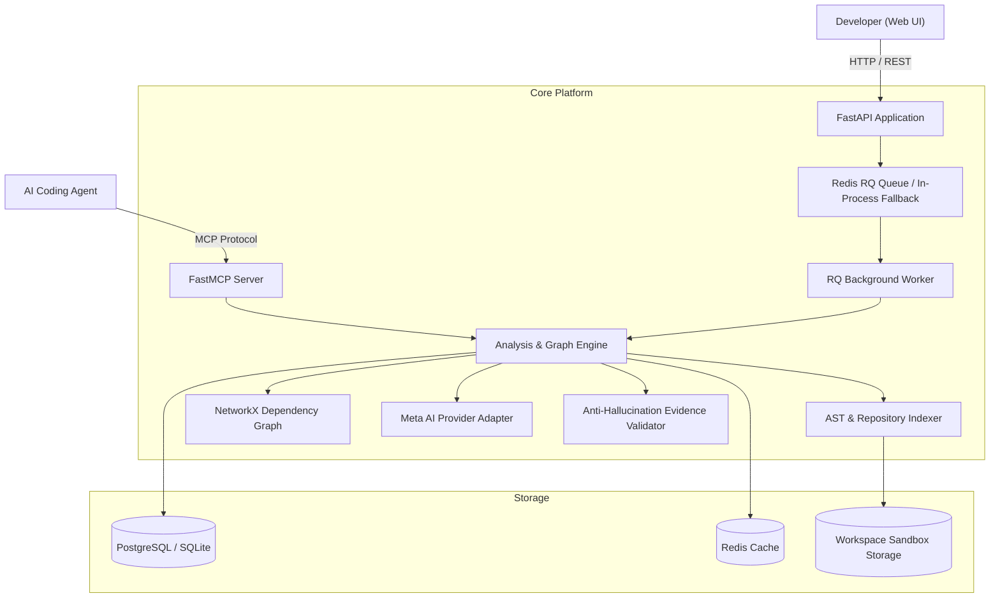

# ScopeGraph — Agent Guidelines & Repository Architecture Standard

> **Crucial Rule for All Agents:**
> ScopeGraph is an AI-powered code intelligence and change impact analysis platform. This document defines the engineering standards, architecture rules, conventions, and mandatory workflows for all AI coding agents working on this repository.
> Every agent must inspect existing code, preserve user uncommitted work, and strictly verify implementations against verified facts before editing or committing code.

---

## 1. Project Overview

ScopeGraph helps software engineers and AI coding agents understand the blast radius and architectural impact of code changes **before** writing code.

- **Primary Problem Solved**: Eliminates guesswork and hallucinations when planning code changes. Prevents breaking downstream dependencies, missing database migrations, or overlooking test coverage.
- **Target Users**:
  1. **Software Developers**: Visually inspect dependency graphs, explore architectural tiers (`api`, `service`, `model`, `core`, `test`), inspect source-grounded evidence snippets, and review implementation checklists.
  2. **AI Coding Agents** (Claude Code, Cursor, Codex): Query grounded context and call native Model Context Protocol (MCP) tools (`analyze_change`, `get_relevant_context`, `suggest_tests`) to receive structured briefs instead of dumping whole codebases into context windows.
- **Repository URL**: `https://github.com/teehihi/scope-graph`

---

## 2. Current Implementation Status

Agents must distinguish between **Implemented**, **Partially Implemented**, and **Planned** components.

| Component | Status | Verified Implementation Location |
| :--- | :--- | :--- |
| **Python AST Parser** | **Implemented** | `services/api/app/indexing/parser.py` (extracts classes, methods, FastAPI/Flask endpoints, SQLAlchemy models, calls, imports) |
| **Workspace Scanner & Zip-Slip Sandbox** | **Implemented** | `services/api/app/indexing/scanner.py`, `services/api/app/core/security.py` (safe extraction, canonical path checking, quota enforcement) |
| **Database & ORM** | **Implemented** | `services/api/app/db/models.py`, `database.py` (SQLAlchemy 2.0, PostgreSQL 16 + SQLite zero-config fallback, Alembic) |
| **Graph Traversal Engine** | **Implemented** | `services/api/app/graph/engine.py` (NetworkX DiGraph, upstream/downstream traversals, React Flow coordinate generation) |
| **Anti-Hallucination Evidence Gate** | **Implemented** | `services/api/app/evidence/validator.py` (checks claims against DB facts, rejects non-existent files/symbols, extracts line snippets) |
| **Multi-Pass Impact Orchestrator** | **Implemented** | `services/api/app/analysis/orchestrator.py` (7-step pipeline: Interpret -> Retrieve -> Traverse -> Reason -> Review -> Ground -> Brief) |
| **AI Inference Providers** | **Implemented** | `services/api/app/ai/provider.py` (`OfflineDemoProvider` for zero-key local demo; `MetaAIHttpProvider` for Meta Model API, Fireworks, Baseten, Together, Groq) |
| **Model Context Protocol (MCP)** | **Implemented** | `services/api/app/mcp/server.py` (`FastMCP`/`MCPServer` exposing `analyze_change`, `get_relevant_context`, `suggest_tests`) |
| **Background Task Queue & Caching**| **Implemented** | `services/api/app/jobs/queue.py`, `tasks.py`, `worker.py` (Redis RQ with in-process sync fallback; SHA-256 analysis caching) |
| **REST API Layer** | **Implemented** | `services/api/app/api/routes/` (`repositories.py`, `analysis.py`, `health.py`) |
| **Web Dashboard & Visualizer** | **Implemented** | `apps/web/` (React 18, Vite 6, Tailwind CSS 3.4, `@xyflow/react` v12.4, Lucide icons, client-side router, layout shells) |
| **Multi-Language Parsing (TS/JS/Go)** | **Partially Implemented** | File language detection exists (`scanner.py`), but AST symbol/call resolution currently supports Python only. |
| **Authentication Backend** | **Partially Implemented** | Client-side `AuthContext` (localStorage demo persistence) exists; backend API is currently stateless without JWT/session tables. |
| **Direct Git Clone Ingestion** | **Planned** | Currently ingests via ZIP archive upload or bundled sample microservice (`/load-sample`). |
| **Modal / Custom Inference Cluster**| **Planned / Config** | `settings.META_AI_PROVIDER` accepts `modal`, but server currently connects via standard HTTP OpenAI-compatible endpoint. |

---

## 3. Product Principles

1. **Deterministic Code Grounding First**: Semantic reasoning by LLMs must never replace static code analysis. Facts (file existence, symbol signatures, call hierarchies) originate from AST parsing in the database.
2. **Strict Anti-Hallucination Evidence Gate**: Every file path, symbol, and line reference suggested by AI models must be validated against PostgreSQL. Claims that fail verification are categorized as `rejected_hallucinations`.
3. **Evidence Snippets with Line Numbers**: All identified impact items must reference concrete line ranges (`line_start`, `line_end`) and formatted code snippets (`line: 4d | code`).
4. **Honest Confidence Levels**: Differentiate between direct modifications (`direct`), downstream cascade impacts (`indirect`), and potential risks (`risks`). Never declare a component definitely affected if the system only established potential impact.
5. **Human & Agent Control**: Provide structured insights and actionable briefs; do not execute unilateral, ungrounded code modifications across repositories.

---

## 4. Architecture Rules & Boundaries



### 4.1 Backend Architecture Boundaries (`services/api`)
- **`app/core/`**: Configuration (`config.py` via `pydantic-settings`), logging (`logging.py`), and zip-slip security sandboxing (`security.py`). No business logic.
- **`app/db/`**: SQLAlchemy declarative models (`models.py`) and session lifecycle (`database.py`). Keep ORM models isolated from API presentation logic.
- **`app/indexing/`**:
  - `scanner.py`: Workspace directory scanning, file size filtering, language classification, SHA-256 calculation.
  - `parser.py`: Pure AST parsing returning `CodeParseResult`. Must remain side-effect-free (no DB calls).
  - `engine.py`: Coordinates scanning, parsing, module path resolution, and persistence into `IndexedFile`, `IndexedSymbol`, and `DependencyEdge`.
- **`app/graph/`**: NetworkX graph computation. Calculates architectural tiers (`determine_layer`), in/out degree traversals, and React Flow node/edge layouts.
- **`app/ai/`**: Meta AI provider abstraction (`BaseMetaAIProvider`).
  - `MetaAIHttpProvider`: Handles external HTTP inference with JSON-mode stripping and timeout protection.
  - `OfflineDemoProvider`: Fallback deterministic matcher for instant, zero-cost, network-free demonstration.
- **`app/evidence/`**: `EvidenceValidator` verifies claims against DB records and reads safe disk snippets with line numbers.
- **`app/analysis/`**: `AnalysisOrchestrator` runs the 7-step pipeline. Does not handle HTTP transport.
- **`app/jobs/`**: Redis RQ queuing, tasks (`task_index_repository`, `task_run_analysis`), worker script, and SHA-256 result caching. Must support graceful synchronous fallback if Redis is down.
- **`app/mcp/`**: Standalone MCP server exposing tool interfaces. Must use `SessionLocal` context managers with guaranteed cleanup (`finally: db.close()`).
- **`app/api/routes/`**: FastAPI routers. Handlers must stay thin, delegating heavy logic to `IndexingEngine` or `AnalysisOrchestrator`.

### 4.2 Frontend Architecture Boundaries (`apps/web`)
- **`src/types/`**: TypeScript interfaces matching backend response models (`Repository`, `NodeData`, `ImpactItem`, `AnalysisReport`, `LayerType`).
- **`src/api/client.ts`**: Centralized HTTP client fetching `/api/v1/*` endpoints. No raw `fetch()` calls inside UI components.
- **`src/router.tsx`**: Lightweight client-side router (`RouterProvider`, `useRouter`, `Link`) supporting query params and browser history.
- **`src/context/`**:
  - `AuthContext.tsx`: Client authentication state, demo user login, and route guarding.
  - `RepoContext.tsx`: Active repository state, graph nodes/edges sync, analysis execution, and node/evidence drawer selection.
- **`src/components/layouts/`**: `AppLayout` (sidebar, breadcrumb, user bar), `AuthLayout`, `MarketingLayout`.
- **`src/pages/`**: Route components (`Dashboard`, `Graph`, `Impact`, `Repositories`, `Settings`, `Landing`, `Login`, `Register`, `NotFound`).
- **`src/components/`**: Modular presentation components (`GraphCanvas`, `ScopeNode`, `ReportPanel`, `EvidenceDrawer`, `RequirementPanel`, `BrandIcons`, `UploadModal`).

---

## 5. Coding Conventions

### 5.1 Python / Backend
- **Target Runtime**: Python 3.13+.
- **Typing**: Use standard Python 3.10+ union types (`str | None`, `list[dict[str, Any]]`). Do not use deprecated `typing.Optional` or `typing.List` in new code.
- **Database Sessions**: Always utilize FastAPI dependency injection (`db: Session = Depends(get_db)`) in route handlers. In background tasks, scripts, and MCP tools, instantiate `SessionLocal()` and guarantee release with `try...finally: db.close()`.
- **Error Handling**: Use `fastapi.HTTPException` with explicit status codes and informative `detail` messages. Catch specific exceptions; never use bare `except:` without logging.
- **Logging**: Use standard module loggers: `logger = logging.getLogger(__name__)`. Never use `print()` statements for application logging.
- **Pydantic Models**: Use Pydantic v2 conventions (`BaseModel`, `Field`, `SettingsConfigDict`).

### 5.2 TypeScript / Frontend
- **Target Runtime**: React 18, TypeScript 5.7+ (Strict mode).
- **Component Style**: Functional components typed with `React.FC<Props>`.
- **State Flow**: Use React Context (`useRepo()`, `useAuth()`, `useRouter()`) for application-wide state. Keep local UI state (e.g. accordion open/close, search input) local.
- **Class Merging**: Use `clsx` and `tailwind-merge` (`twMerge`) for conditional Tailwind CSS classes.
- **Icons**: Use `lucide-react` icons. Maintain consistent sizes (`w-4 h-4`, `w-5 h-5`).
- **Path References**: Use relative imports within `src/` following the existing structure.

---

## 6. Frontend Design System & Brand Identity

ScopeGraph adheres to the **Brand Kit v2** specifications:

### 6.1 Brand Colors & Tokens
- **Ink (`#151923`)**: Primary text, dark sidebar, header titles, active icons.
- **Warm White (`#F7F8F5`)**: Primary application background, neutral card canvas.
- **Electric Lime (`#C7F36B`)**: Accent color, active triggers, primary button CTA, highlighted node indicators. (Use sparingly as an accent).
- **Graph Blue (`#526BEE`)**: Active graph edges, standard dependency nodes, links, focused inputs.
- **Scout Blue (`#7CC7FF`)**: Eyes and highlights of Scout mascot, secondary visual cues.
- **Muted Gray (`#8B929E`)**: Subtext, inactive icons, graph handles, node borders.
- **Border Gray (`#E4E7E1`)**: Card borders, divider lines, table borders.
- **Halo (`#EDF0F7`)**: Subdued background badges, node container halos.
- **Amber Brand (`#F5A623`)**: Downstream/indirect change impact, cautionary regression risks.
- **Red Brand (`#E5484D`)**: Direct change impact, critical error states, hallucination rejections.

### 6.2 Typography
- **UI / Headings / Wordmark**: `font-sans` (`Inter`, system-ui, sans-serif).
- **Code / Monospace**: `font-mono` (`JetBrains Mono`, monospace) for code snippets, file paths, and symbol signatures.

### 6.3 Mascot & Brand Assets (`docs/scopegraph-brand-final/`)
- **Mascot ("Scout")**: White hood, black visor, blue eyes (`#7CC7FF`), lime accent antenna (`#C7F36B`).
- **Status Representations**: Use standardized SVGs from `docs/scopegraph-brand-final/status/` for empty states (`empty-graph`, `no-impact`, `analysis-progress`, `potentially-affected`, `analysis-completed`).
- **Role Glyphs**: developer, ai-agent, reviewer, maintainer, project-owner, tester, observer.

---

## 7. Development & Verification Commands

Agents must only execute verified commands from the project configuration.

### 7.1 Local Standalone Development
```bash
# 1. Setup Backend Virtualenv & Dependencies
python3 -m venv .venv
source .venv/bin/activate
pip install -r services/api/requirements.txt

# 2. Database Migrations (if using PostgreSQL/Alembic)
cd services/api && alembic upgrade head

# 3. Start Backend API (Port 8000)
cd services/api && uvicorn app.main:app --reload --port 8000

# 4. Start Frontend Dev Server (Port 5173)
cd apps/web && npm install && npm run dev

# 5. Start Background Worker (Optional if Redis enabled)
cd services/api && python -m app.jobs.worker

# 6. Start Native MCP Server
cd services/api && python -m app.mcp.server
```

### 7.2 Docker Orchestration
```bash
# Build and run full containerized stack (API, Web, Worker, Postgres, Redis)
docker compose up --build -d

# Check service health and logs
docker compose ps
docker compose logs -f api

# Stop and clean up containers
docker compose down -v
```

### 7.3 Testing & Quality Verification
```bash
# Run backend pytest suite (all 6 automated tests)
source .venv/bin/activate
PYTHONPATH=services/api pytest services/api/tests/ -v

# Run frontend TypeScript typecheck and production build
cd apps/web && npm run build
```

---

## 8. Mandatory Agent Workflow

Every agent undertaking work on ScopeGraph must follow these operational steps:

1. **Pre-Flight Context Review**:
   - Check `git status` and `git diff` before touching any file.
   - Do **NOT** overwrite, revert, or format uncommitted changes made by the user.
2. **Consult Architecture & Schema**:
   - For database schema changes: Update `services/api/app/db/models.py` and generate an Alembic migration (`alembic revision --autogenerate`).
   - For graph logic changes: Update `services/api/app/graph/engine.py` and verify `test_graph.py`.
   - For UI changes: Check `apps/web/src/types/index.ts` to ensure consistency with API payloads.
3. **Preserve Sandboxing & Security**:
   - Never bypass Zip-Slip protections or increase resource quotas without explicit justification.
   - Never log unredacted authorization keys or user passwords.
4. **Targeted, Minimal Modifications**:
   - Avoid massive speculative refactoring. Make small, focused, verifiable modifications.
   - Do not install new dependencies unless strictly necessary and approved.
5. **Post-Change Verification**:
   - Backend changes: Execute `PYTHONPATH=services/api pytest services/api/tests/ -v`.
   - Frontend changes: Execute `cd apps/web && npm run build` (tsc + vite build).
6. **Transparent Reporting**:
   - Detail every file created or modified.
   - Report test outputs and build status.
   - Explicitly highlight any unverified assumptions or limitations.

---

## 9. Prohibited Practices

Agents are strictly forbidden from the following:

- ❌ **No Speculative Architectural Divergence**: Do not create parallel graph engines, new state management libraries (e.g. Redux), or alternative styling frameworks (e.g. styled-components) when the repository already has standard implementations.
- ❌ **No Destructive Git Actions**: Never run `git reset --hard`, `git checkout -- .`, or `git clean -fd`. Never discard uncommitted work.
- ❌ **No Fake Test Passes**: Never claim tests passed without running the command and inspecting the exit code.
- ❌ **No Hardcoded Secrets**: Never commit real API keys, bearer tokens, or database passwords. Use `.env` with fallback to `OfflineDemoProvider`.
- ❌ **No Unvalidated AI Hallucinations**: Never bypass `EvidenceValidator` to directly display raw LLM output in the UI without index grounding.
- ❌ **No Deletion of Existing Documentation**: Do not remove `README.md`, `docs/ARCHITECTURE.md`, `docs/MCP_SETUP.md`, or brand assets.

---

## 10. Agent Prompting & MCP Integration Quick Reference

When external AI agents connect to ScopeGraph via MCP:
- **`analyze_change(repository_id, requirement)`**:
  - Run to obtain verified impact items, direct/indirect files, regression risks, and suggested tests.
- **`get_relevant_context(repository_id, query, limit)`**:
  - Run before proposing file changes to retrieve exact symbol locations and real source code previews.
- **`suggest_tests(repository_id, requirement)`**:
  - Run to inspect existing repository tests (`tests/test_*.py`) and derive regression test specifications.
