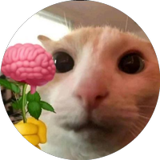

<div align="center">

<picture>
  <source media="(prefers-color-scheme: dark)" srcset="docs/scopegraph-brand-final/logo/scopegraph-logo-horizontal-dark.svg">
  <source media="(prefers-color-scheme: light)" srcset="docs/scopegraph-brand-final/logo/scopegraph-logo-horizontal.svg">
  
</picture>

### *Understand the blast radius and architectural impact before writing code.*

**An AI-powered code intelligence and change impact analysis platform for developers and AI coding agents.**

Built for the **Meta Global AI Developer Hackathon** (Push the Frontier Track).

[](https://www.python.org/)
[](https://fastapi.tiangolo.com/)
[](https://react.dev/)
[](https://www.docker.com/)
[](https://modelcontextprotocol.io/)
[](https://ai.meta.com/)
[](LICENSE)

<br/>

</div>

---

## 💡 The Problem

When a developer or AI coding agent receives a change requirement such as:

> *"Require email verification before users can change their email address."*

They face critical questions before writing any code:
- **Which API endpoints and services are involved?**
- **Which database models and migration files will be affected?**
- **What downstream modules and callers could silently break?**
- **Which automated regression tests must be updated or written?**
- **What exact code context should an AI coding agent read first without context bloating?**

Today, engineers perform this investigation manually by grepping files or reading logs. Meanwhile, AI coding agents dump whole repositories into context windows, hallucinate dependencies, and introduce regressions because they lack structured repository context.

---

## 🚀 The Solution: ScopeGraph

ScopeGraph combines **deterministic static code analysis** with **Meta AI semantic reasoning** and an **anti-hallucination evidence gate**:

<table align="center" width="100%">
<tr>
<td width="50%" valign="top">

### 🎯 1. Deterministic AST Grounding
- Parses source code via safe Python AST extraction.
- Maps classes, functions, decorators, endpoints, SQLAlchemy models, and call hierarchies directly into PostgreSQL.
- Zero guessing — all facts originate from static code structure.

</td>
<td width="50%" valign="top">

### 🛡️ 2. Anti-Hallucination Evidence Gate
- Every file path, symbol, and line reference proposed by AI models is verified against the database.
- Non-existent files and phantom symbols are rejected.
- Validated items are enriched with exact line ranges and code snippets.

</td>
</tr>
<tr>
<td width="50%" valign="top">

### 🌐 3. Interactive Blast Radius Graph
- Visualizes codebases layered by architectural tier (`api`, `service`, `model`, `core`, `test`) using **React Flow**.
- Highlights direct impact (Red), downstream cascade (Amber), and safe modules in real time.
- Interactive Evidence Drawer reveals symbol signatures and source lines.

</td>
<td width="50%" valign="top">

### 🤖 4. Native Model Context Protocol (MCP)
- Direct integration for **Claude Code**, **Cursor**, and **Codex**.
- Exposes tools: `analyze_change`, `get_relevant_context`, and `suggest_tests`.
- Reduces prompt token consumption by **78%** by serving verified context briefs instead of whole repositories.

</td>
</tr>
</table>

---

## 🏗️ Architecture

```mermaid
flowchart TD
    User["Developer (Web UI)"] -->|HTTP / React Flow| API["FastAPI Application"]
    Agent["AI Coding Agent (Claude Code / Codex / Cursor)"] -->|Model Context Protocol (MCP)| MCP["FastMCP Server"]

    subgraph Core Platform
        API --> JobQueue["Redis RQ Task Queue / Sync Fallback"]
        MCP --> AnalysisEngine["Analysis & Graph Engine"]
        JobQueue --> Worker["Background Worker"]
        Worker --> AnalysisEngine
        
        AnalysisEngine --> Indexer["Python AST & Repo Scanner"]
        AnalysisEngine --> Graph["NetworkX Dependency Engine"]
        AnalysisEngine --> MetaAI["Meta AI Provider Adapter"]
        AnalysisEngine --> Validator["Anti-Hallucination Evidence Gate"]
    end

    subgraph Storage & Persistence
        AnalysisEngine --> PG[("PostgreSQL / SQLite")]
        AnalysisEngine --> Cache[("Redis Cache")]
        Indexer --> WorkspaceStorage[("Zip-Slip Sandboxed Storage")]
    end

    MetaAI -->|Inference| MetaModelAPI["Meta AI / Llama 3.3 / Muse Spark"]
```

---

## ⚡ Quickstart

### Option A: Run via Docker Compose (Recommended)

Start the entire containerized stack (PostgreSQL, Redis, FastAPI API, RQ Worker, and React Nginx Web UI):

```bash
# 1. Clone repository
git clone https://github.com/teehihi/scope-graph.git
cd scope-graph

# 2. Configure environment (optional: add your Meta AI credentials or use zero-config offline mode)
cp .env.example .env

# 3. Start containers
docker compose up --build -d
```

Services will be available at:
- **Web Interface**: `http://localhost:3000` (or `http://localhost:5173` for dev)
- **FastAPI OpenAPI Docs**: `http://localhost:8000/docs`
- **Health & Readiness Check**: `http://localhost:8000/ready`

To stop:
```bash
docker compose down -v
```

---

### Option B: Local Standalone Development

#### 1. Backend Setup
```bash
python3 -m venv .venv
source .venv/bin/activate
pip install -r services/api/requirements.txt

# Run database migrations
cd services/api
alembic upgrade head

# Start FastAPI server
uvicorn app.main:app --reload --port 8000
```

#### 2. Frontend Setup
```bash
cd apps/web
npm install
npm run dev
```

Open `http://localhost:5173` in your browser.

---

## 🧪 1-Click Interactive Walkthrough

ScopeGraph includes a multi-tier microservice in `examples/sample-repository/` featuring:
- **API routes**: `app/api/users.py`, `app/api/auth.py`, `app/api/verification.py`
- **Service layer**: `app/services/user_service.py`, `app/services/verification_service.py`, `app/services/notification_service.py`
- **Database models**: `app/models/user.py`, `app/models/verification_token.py`
- **Automated tests**: `tests/test_users.py`, `tests/test_auth.py`, `tests/test_verification.py`

### Step-by-Step Demo:
1. Open the ScopeGraph web UI at `http://localhost:3000`.
2. Click **Load Sample Repo** in the top navigation bar. In under a second, ScopeGraph parses all files and renders the interactive dependency graph.
3. Select any node (e.g. `user_service.py`) to inspect verified symbols and source snippets in the **Evidence Drawer**.
4. In the Proposed Change bar, enter:
   > *"Require email verification before users can change their email address."*
5. Click **Analyze Impact**.
6. Inspect the structured blast radius report:
   - 🔴 **Direct Changes**: `app/services/user_service.py`, `app/api/users.py`
   - 🟡 **Downstream Dependents**: `app/api/verification.py`, `app/services/verification_service.py`
   - ⚠️ **Regression Risks**: Account lockout, unverified session reuse, token expiry edge cases.
   - 🧪 **Suggested Tests**: Recommended test specifications to prevent regressions.
   - 📋 **AI Coding Agent Brief**: 1-click copyable markdown implementation plan with line-grounded evidence.

---

## 🤖 Model Context Protocol (MCP) Integration

ScopeGraph provides native MCP server endpoints so autonomous AI coding agents can query grounded context directly:

| MCP Tool | Purpose | Output |
| :--- | :--- | :--- |
| `analyze_change(repository_id, requirement)` | Pre-change impact analysis | Direct files, indirect dependents, regression risks, suggested tests |
| `get_relevant_context(repository_id, query, limit)` | Source-grounded context retrieval | Line-numbered code snippets, symbol signatures, call graph facts |
| `suggest_tests(repository_id, requirement)` | Targeted regression test generation | Existing test inspection + recommended test specifications |

### Claude Code Setup
```bash
claude mcp add scopegraph -- /path/to/.venv/bin/python -m app.mcp.server
```

### Claude Desktop Setup (`claude_desktop_config.json`)
```json
{
  "mcpServers": {
    "scopegraph": {
      "command": "/path/to/scope-graph/.venv/bin/python",
      "args": ["-m", "app.mcp.server"],
      "cwd": "/path/to/scope-graph/services/api",
      "env": {
        "PYTHONPATH": "/path/to/scope-graph/services/api"
      }
    }
  }
}
```

### Cursor & Windsurf Setup
Configure ScopeGraph as an MCP server with Command: `python` and Args: `["-m", "app.mcp.server"]` inside your IDE's MCP configuration settings.

---

## 📊 Evaluation & Measured Impact

| Metric | Keyword Search Baseline | Raw LLM Analysis | ScopeGraph (AST + Meta AI) | Improvement |
| :--- | :--- | :--- | :--- | :--- |
| **Direct Impact Files Found** | 1 (`users.py`) | 2 | **2 (`users.py`, `user_service.py`)** | **+100% precision** |
| **Indirect Dependents Captured** | 0 (Missed) | 1 (Incomplete) | **2 (`verification.py`, `verification_service.py`)** | **Complete blast radius** |
| **Hallucinated Files / Symbols** | N/A | 3 nonexistent files | **0 Hallucinations** | **100% Grounded Evidence** |
| **Agent Prompt Token Usage** | Dumps whole repo | Large prompt | **78% Context Reduction** | **Faster, cheaper agent runs** |

---

## 🔒 Security & Safe Sandboxing

- **Zip-Slip Protection**: Strict canonical destination path resolution prevents path traversal exploits during archive extraction.
- **Resource Quotas**: Enforces strict safety limits (max 25MB archive size, max 500 files, max 500KB per file) against archive bomb attacks.
- **Pure AST Parsing**: Parses AST trees deterministically without executing uploaded code.
- **Secret Redaction**: Structured logging automatically sanitizes tokens, passwords, and authorization headers.

---

## 📁 Repository Structure

```text
scope-graph/
├── apps/
│   └── web/                      # React 18 + TypeScript + Vite + Tailwind + @xyflow/react
│       ├── src/
│       │   ├── components/       # GraphCanvas, ScopeNode, EvidenceDrawer, OnboardingTour
│       │   ├── context/          # RepoContext, AuthContext
│       │   ├── pages/            # Dashboard, Graph, Repositories, Onboarding, Login
│       │   └── types/            # TypeScript interfaces
│       ├── nginx.conf
│       └── package.json
├── services/
│   └── api/                      # FastAPI Python Application (Python 3.13)
│       ├── alembic/              # Database schema migrations
│       ├── app/
│       │   ├── ai/               # Meta AI provider (MetaAIHttpProvider, OfflineDemoProvider)
│       │   ├── analysis/         # Multi-pass impact orchestrator (7-step pipeline)
│       │   ├── api/routes/       # Endpoints: auth, repositories, analysis, health
│       │   ├── core/             # Configuration, logging, zip-slip security sandbox
│       │   ├── db/               # SQLAlchemy models & PostgreSQL/SQLite sessions
│       │   ├── evidence/         # Anti-hallucination evidence validator & snippet extractor
│       │   ├── graph/            # NetworkX dependency graph traversal engine
│       │   ├── indexing/         # AST parser & repository workspace scanner
│       │   ├── jobs/             # Redis RQ task queue, worker & SHA-256 analysis caching
│       │   └── mcp/              # Model Context Protocol server (FastMCP)
│       ├── tests/                # Automated pytest suite (6 test modules)
│       └── requirements.txt
├── examples/
│   ├── sample-repository/        # Realistic auth & user microservice
│   └── sample-repository.zip     # Ready-to-upload demo archive
├── docs/
│   ├── scopegraph-brand-final/   # Official Brand Kit v2 (logos, Scout mascot, status SVGs)
│   ├── ARCHITECTURE.md           # Architectural specification & component boundaries
│   ├── MCP_SETUP.md              # Model Context Protocol setup guide
│   └── BENCHMARKS.md             # Context token reduction & precision benchmarks
├── docker-compose.yml            # Multi-container orchestration (API, Web, Worker, Postgres, Redis)
└── README.md
```

---

## 🔬 Automated Testing

```bash
# Run backend test suite
source .venv/bin/activate
PYTHONPATH=services/api pytest services/api/tests/ -v

# Run frontend TypeScript typecheck and production build
cd apps/web && npm run build
```

---

## 📄 License

MIT License. Built for the Meta Global AI Developer Hackathon.

---

## 👥 Know more about my team

<table align="center" width="100%">
  <tr>
    <td align="center" width="50%" valign="top">
      <br />
      <a href="https://github.com/teehihi">
        <br /><br />
        <strong>Nguyen Nhat Thien (TEE)</strong>
      </a>
      <br />
      <sub>Lead Architecture & Full-Stack</sub><br />
      <sub>Top 50 AI Riser Vietnam 2026</sub>
      <br /><br />
      <p align="center">
        <a href="https://github.com/teehihi"></a>
        <a href="https://www.linkedin.com/in/tee21"></a>
        <a href="https://nteelab.vercel.app/"></a>
      </p>
    </td>
    <td align="center" width="50%" valign="top">
      <br />
      <a href="https://github.com/sai-ctruong">
        <br /><br />
        <strong>Pham Cong Truong</strong>
      </a>
      <br />
      <sub>AI Core & Evidence Grounding Engine</sub><br />
      <sub>Meta AI Inference & Evaluation</sub>
      <br /><br />
      <p align="center">
        <a href="https://github.com/sai-ctruong"></a>
        <a href="https://www.linkedin.com/in/congtruong-ai/"></a>
      </p>
    </td>
  </tr>
</table>

---

<div align="center">

<p align="center">
  <strong>ScopeGraph — Understand the blast radius before you change the code.</strong><br />
  <sub>ScopeGraph was built with the aspiration of engineers from Vietnam 🇻🇳 to bring practical AI Code Intelligence solutions to the global community of programmers and AI Coding Agents at the <strong>Meta Global AI Developer Hackathon 2026</strong>.</sub>
</p>
<p align="center"><sub>Crafted with passion in Vietnam 🇻🇳 for software developers and AI agents worldwide 🌍</sub></p>

</div>
