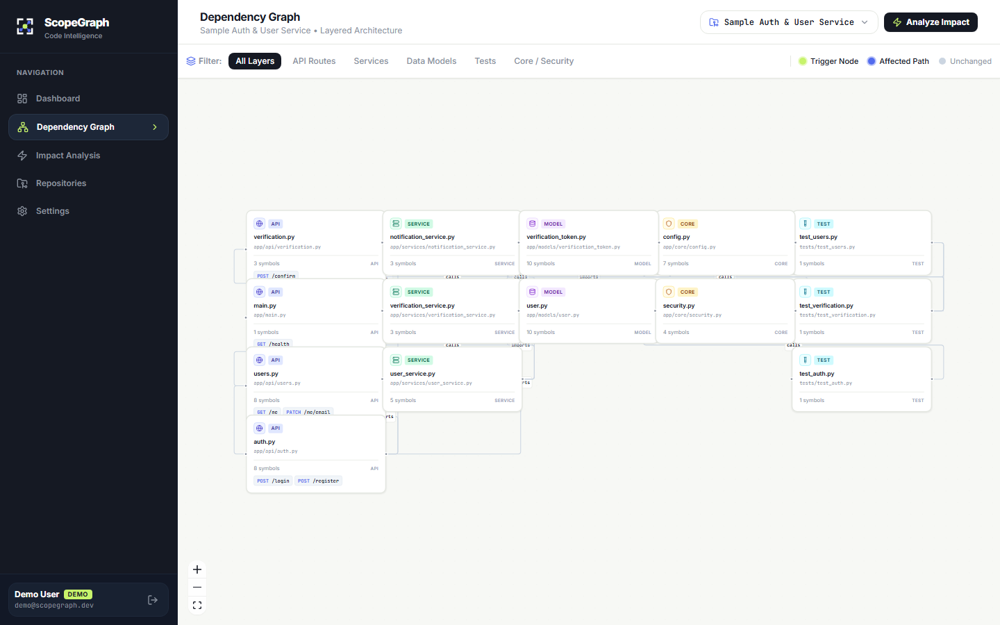
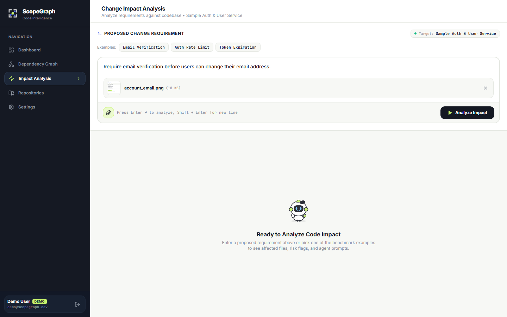
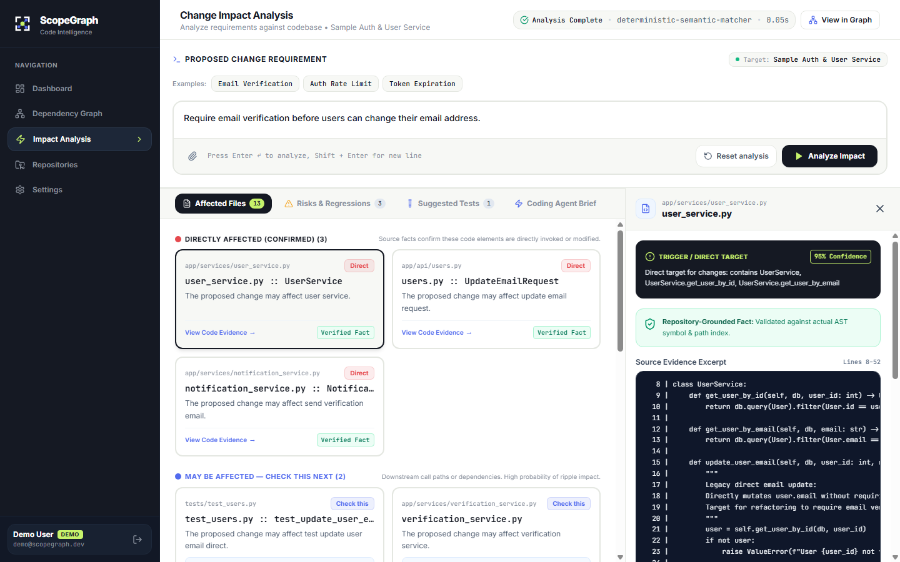
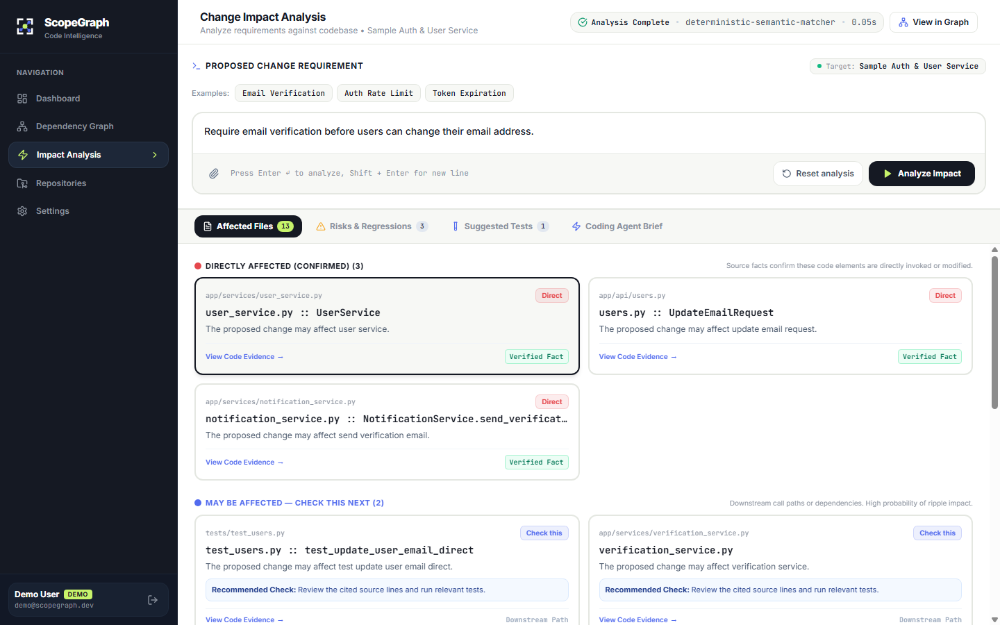
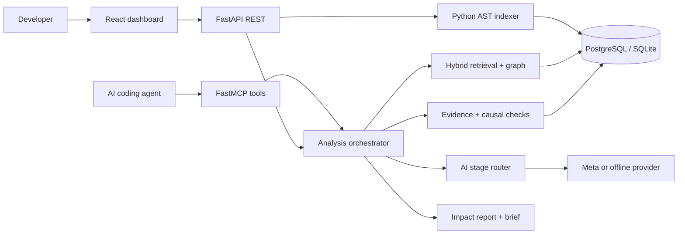
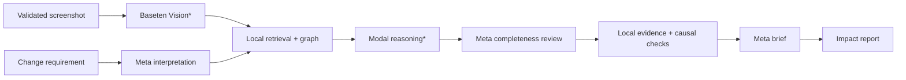

<div align="center">


<picture>
  <source media="(prefers-color-scheme: dark)" srcset="docs/scopegraph-brand-final/logo/scopegraph-logo-horizontal-dark.svg" />
  
</picture>

### Understand the impact before changing the code.

**ScopeGraph maps a change request to an indexed codebase, then shows the evidence behind its proposed blast radius.**

[](services/api/requirements.txt)
[](apps/web/package.json)
[](docs/MCP_SETUP.md)
[](LICENSE)

[Demo](#demo--product-preview) &nbsp;·&nbsp; [Features](#key-features) &nbsp;·&nbsp; [Architecture](#system-architecture) &nbsp;·&nbsp; [Quick start](#quick-start)

</div>

## Demo & product preview

The hero artwork is illustrative. The product images below are **captures of the running local app** using the bundled, non-private [sample repository](examples/sample-repository/). The impact report uses the deterministic `offline_demo` provider. The screenshot is shown attached **before inference**; offline mode does not interpret images. See the [three-minute demo plan](docs/HACKATHON_FINAL_READINESS.md) and [current submission status](docs/HACKATHON_SUBMISSION.md).

### 01 / Explore the dependency graph

Python files are organized by API, service, model, core and test layers. Select a node to inspect indexed symbols and connections.



### 02 / Bring visual context to a change request

Attach a PNG or JPEG alongside the requirement. A configured vision provider can interpret what is visible; screenshot observations are kept separate from verified source evidence.



### 03 / Inspect the claim and its source

The report separates direct, indirect and potential impacts, with file paths, symbols and line-numbered excerpts. This capture is from **offline demo inference**: “verified” means the cited code exists in the index, not that the proposed edit is certainly required.



<details>
<summary>See the full report view</summary>



</details>

## Why ScopeGraph?

| Before editing | ScopeGraph gives you |
| --- | --- |
| A requirement with unclear blast radius | Candidate edit targets, downstream behavior and potential risks in separate categories |
| A large repository and limited context | Relevant indexed files and graph neighbors instead of a whole-repository dump |
| An AI suggestion without a traceable basis | A checked file/symbol reference and a source excerpt with line numbers |

ScopeGraph is a **planning aid**. Static indexing supplies facts; model reasoning proposes relationships; developers decide which changes are necessary.

## Key features

| Capability | What is available |
| --- | --- |
| Repository-aware impact analysis | Python AST indexing, hybrid retrieval, graph traversal and a multi-pass analysis report |
| Visual dependency exploration | Interactive React Flow graph with architectural layers and file-level connections |
| Impact separation | Direct, indirect and potential items are displayed separately; causal classification adds checks beyond file existence |
| Screenshot-to-Impact | PNG/JPEG upload and visual-context contract are implemented; an actual vision provider is required. Local browser integration is mock-verified; one prior Meta **vision-only** smoke request succeeded. |
| Source evidence | Indexed path/symbol validation, rejected unsupported references and line-numbered excerpts |
| Agent access | FastMCP tools: `analyze_change`, `get_relevant_context`, `suggest_tests` |
| Optional Multi-AI routing | Configured stage routing can select Baseten Vision and Modal reasoning; partner live inference remains **unverified** |

## How it works

`Index repository → interpret requirement (and optional image) → retrieve context → traverse graph → reason about impact → review completeness → validate and classify claims → generate brief`

The evidence gate rejects references to missing indexed files or symbols. It cannot, by itself, prove that an existing file needs modification. [Architecture details](docs/ARCHITECTURE.md) · [Screenshot contract](docs/SCREENSHOT_TO_IMPACT_CONTRACT.md)

## System architecture



Indexing and evidence checks stay local. Redis RQ can queue background jobs; an in-process fallback keeps local development usable without Redis. [Explore the source-backed system diagram](docs/diagrams/system-architecture.html) (standalone HTML; download and open locally).

## Multi-AI architecture

`meta_only` is the default: all inference stages use the configured Meta-compatible provider or deterministic offline demo. The **opt-in, experimental** `multi_ai` profile requires approved endpoints, credentials and capability flags:



`*` Baseten and Modal deployment behavior is **not live-verified**. Screenshot interpretation runs only when an image is supplied. The brief receives the grounded result, not raw visual observations. [Explore the source-backed pipeline](docs/diagrams/multi-ai-pipeline.html) (standalone HTML) · [Configuration and safety gates](docs/MULTI_AI_ARCHITECTURE.md)

## Tech stack

| Surface | Components |
| --- | --- |
| Web | React 18, TypeScript, Vite, Tailwind CSS, `@xyflow/react` |
| API and analysis | Python 3.13, FastAPI, SQLAlchemy 2, Python AST, NetworkX |
| Persistence and jobs | PostgreSQL 16 or local SQLite; Redis RQ with synchronous fallback |
| AI and agents | Meta Model API adapter, deterministic offline provider, optional partner routing, FastMCP |

## Quick start

### Local offline demo

The quickest safe path needs **no AI key, PostgreSQL or Redis**. Use Python 3.13 and Node.js; run the API and web app in separate terminals. An existing root `.env` can set PostgreSQL, so the commands explicitly select SQLite for this process.

**Terminal A — API (bash):**

```bash
git clone https://github.com/teehihi/scope-graph.git
cd scope-graph
python3 -m venv .venv
source .venv/bin/activate
pip install -r services/api/requirements.txt
export DATABASE_URL=sqlite:///./data/scopegraph.db
export AI_PROVIDER_PROFILE=meta_only
export META_AI_PROVIDER=offline_demo
cd services/api
uvicorn app.main:app --host 127.0.0.1 --port 8000
```

On Windows PowerShell, use `py -3.13 -m venv .venv`, `.\.venv\Scripts\Activate.ps1` and `$env:NAME='value'` for the three environment variables above.

**Terminal B — web:**

```bash
cd scope-graph/apps/web
npm install
npm run dev -- --host 127.0.0.1
```

Open **http://127.0.0.1:5173/**. The Vite dev server proxies `/api` to the local API. Load the bundled sample repository, then analyze a text requirement. Screenshot inference requires a configured vision-capable provider and is unavailable in offline mode.

Docker Compose configuration is included for isolated development, but the latest local audit could validate its configuration only; Docker Engine was unavailable. The Compose stack exposes development service ports and must **not** be published as-is. [Environment and release gates](docs/HACKATHON_FINAL_READINESS.md)

## Usage

1. Load the bundled sample or upload a ZIP of a repository you are allowed to inspect.
2. Open **Dependency Graph** to explore indexed files and symbols.
3. In **Impact Analysis**, enter a requirement such as “Require email verification before users can change their email address.”
4. Review direct, indirect and potential items, then open **View Code Evidence** for exact source lines.
5. If a vision provider is configured, attach a PNG/JPEG to analyze visual context; inspect observations and code evidence independently.

AI agents can call the three MCP tools for the same indexed context. [MCP setup](docs/MCP_SETUP.md) · [REST/OpenAPI](http://127.0.0.1:8000/docs)

## Evaluation

The historical **three-case** live Meta evaluation reported macro impact F1 **0.282** and indirect recall **0.111**; 27 of 38 accepted impact claims were unsupported by those manual labels. A separate deterministic replay of saved predictions on a **17-case provisional development fixture** yielded strict micro F1 **0.4651**. The datasets and scoring views differ; these numbers do **not** establish improvement or generalization. The separate RealWorld holdout labels remain provisional and should not be tuned against.

[Evaluation methodology and denominators](docs/EVALUATION.md) · [AI Core progress](docs/AI_CORE_PLAN_AND_PROGRESS.md)

## Limitations and security

- Symbol and call resolution is currently strongest for **Python**; other languages are not at the same indexing depth.
- Source validation proves a cited indexed element exists, not that the suggested edit is causally correct. Human review remains necessary.
- Offline demo mode supports text analysis but **not** screenshot interpretation. Baseten/Modal live deployments are unverified.
- Repository and report authorization, runtime inference access, token handling and deployment controls remain **public-release blockers**. Keep development deployments local and use non-sensitive repositories.

[Full hackathon readiness and security audit](docs/HACKATHON_FINAL_READINESS.md)

## Project structure

```text
scope-graph/
├── apps/
│   └── web/                         React dashboard (Vite)
│       ├── src/api/                 HTTP client
│       ├── src/components/          Reusable UI and graph views
│       ├── src/context/             Shared application state and i18n
│       ├── src/pages/               Application screens
│       └── src/types/               API and UI types
├── services/
│   └── api/                         FastAPI backend
│       ├── app/api/                 REST routes
│       ├── app/ai/                  Inference providers
│       ├── app/analysis/            Impact orchestration
│       ├── app/evidence/            Source evidence validation
│       ├── app/graph/               Dependency graph
│       ├── app/indexing/            Repository scanning and parsing
│       ├── app/jobs/                Background work
│       ├── app/mcp/                 Agent tools
│       └── tests/evaluation/        Versioned evaluation fixtures
├── examples/
│   ├── sample-repository/           Bundled demo repository
│   └── holdout-fastapi-realworld/   Separate evaluation snapshot
├── docs/
│   ├── assets/                     README images
│   ├── brand/                      Team avatars
│   └── diagrams/                   Architecture diagrams
├── scripts/                        Evaluation and audit utilities
├── docker-compose.yml              Local container stack
└── README.md
```

## 👥 Know more about my team

<table align="center" width="100%">
  <tr>
    <td align="center" width="50%" valign="top">
      <br />
      <a href="https://github.com/teehihi">
        <br /><br />
        <strong>Nguyen Nhat Thien (TEE)</strong>
      </a>
      <br />
      <sub>Lead Architecture &amp; Full-Stack</sub><br />
      <sub>Top 50 AI Riser Vietnam 2026</sub>
      <br /><br />
      <p align="center">
        <a href="https://github.com/teehihi"></a>
        <a href="https://www.linkedin.com/in/tee21"></a>
        <a href="https://nteelab.vercel.app/"></a>
      </p>
    </td>
    <td align="center" width="50%" valign="top">
      <br />
      <a href="https://github.com/sai-ctruong">
        <br /><br />
        <strong>Pham Cong Truong</strong>
      </a>
      <br />
      <sub>AI Core &amp; Evidence Grounding Engine</sub><br />
      <sub>Meta AI Inference &amp; Evaluation</sub>
      <br /><br />
      <p align="center">
        <a href="https://github.com/sai-ctruong"></a>
        <a href="https://www.linkedin.com/in/congtruong-ai/"></a>
      </p>
    </td>
  </tr>
</table>

<div align="center">
  <p align="center">
    <strong>ScopeGraph — Understand the blast radius before you change the code.</strong><br />
    <sub>ScopeGraph was built with the aspiration of engineers from Vietnam 🇻🇳 to bring practical AI Code Intelligence solutions to the global community of programmers and AI Coding Agents at the <strong>Meta Global AI Developer Hackathon 2026</strong>.</sub>
  </p>
</div>

*Push the Frontier* is the intended project theme; the official submission track and video URL remain to be confirmed. [Submission draft](docs/HACKATHON_SUBMISSION.md)

## License

ScopeGraph is released under the [MIT License](LICENSE). The separately included FastAPI RealWorld holdout snapshot has its own MIT attribution; see its repository manifest before reusing or redistributing it.
