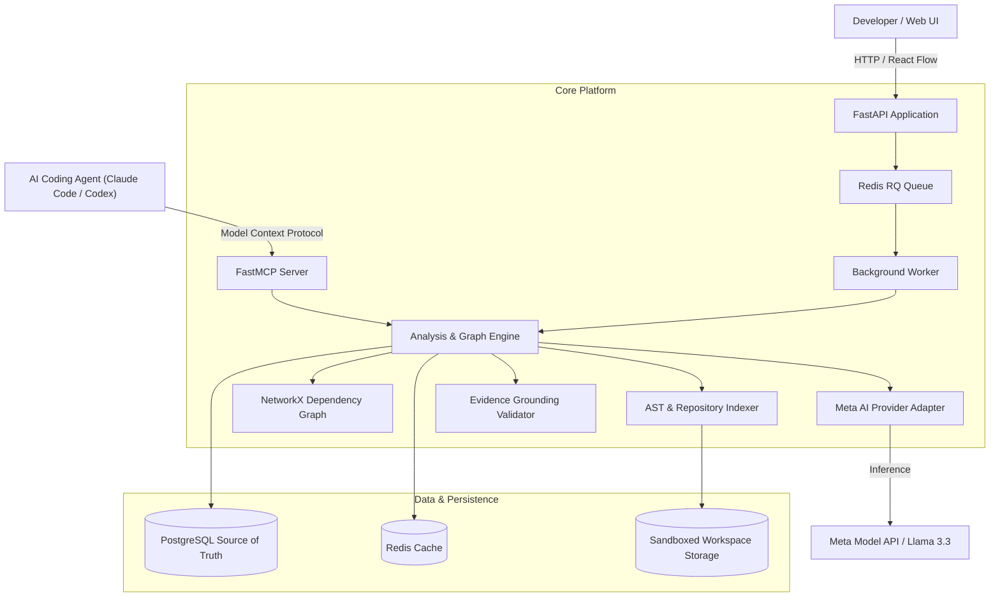

# ScopeGraph Architecture

## 1. System Overview

ScopeGraph is an AI-powered code impact analysis and context retrieval platform that helps developers and AI coding agents understand which parts of a software repository may be affected by a proposed change, why they are affected, and what should be tested before writing code.

## 2. Component Responsibilities

### 2.1 Backend API & MCP Server (`services/api`)
- **FastAPI Core**: Serves RESTful endpoints for workspace management, ZIP uploads, asynchronous indexing, and impact analysis queries.
- **FastMCP Server (`app/mcp/server.py`)**: Exposes native Model Context Protocol tools (`analyze_change`, `get_relevant_context`, `suggest_tests`) allowing AI coding agents to retrieve repository-grounded context.

### 2.2 Repository Indexing Engine (`app/indexing`)
- **Zip-Slip Safe Extraction**: Verifies canonical target paths, enforces quotas (25MB archive, 500 files max, 100MB uncompressed).
- **Python AST Parser**: Deterministically extracts classes, methods, API endpoints (FastAPI/Flask decorators), SQLAlchemy database models, and test cases.
- **Dependency Resolution**: Maps imports and call graphs across repository files.

### 2.3 Dependency Graph Engine (`app/graph`)
- **NetworkX Directed Graph**: Tracks imports, calls, endpoints, and architectural layers (`api`, `service`, `model`, `core`, `test`).
- **React Flow Coordinates**: Generates layered layout coordinates for visual exploration.
- **Graph Traversal**: Computes downstream (dependents/callers) and upstream (dependencies) subgraphs.

### 2.4 Meta AI Semantic Reasoning (`app/ai`)
- **Provider Adapter**: Seamlessly supports official Meta Model API (Muse Spark / Llama 3.3 70B), partner providers (Fireworks, Baseten, Together, Groq), or offline demonstration mode.
- **Structured Prompts**: Multi-pass orchestration:
  1. Requirement Interpretation
  2. Grounded Impact Reasoning
  3. Completeness Review
  4. Coding Agent Brief Generation

### 2.5 Evidence Validation Layer (`app/evidence`)
- **Anti-Hallucination Gate**: Compares every file path and symbol suggested by the AI against the PostgreSQL index. Hallucinations are rejected.
- **Source Excerpt Grounding**: Extracts actual source lines from the repository to visually ground the claim.

### 2.6 Persistence & Infrastructure
- **PostgreSQL**: Source of truth persisting repositories, files, symbols, dependency edges, and analysis runs.
- **Redis**: Powers asynchronous task queues (via RQ) and caches deterministic analysis results.
- **Docker Compose**: Orchestrates `web`, `api`, `worker`, `postgres`, and `redis` with health checks.
