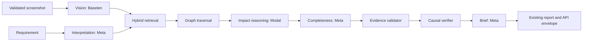

# ScopeGraph Multi-AI architecture

Updated: 2026-10-29. Status: local implementation and mock verification in progress. No Baseten or Modal live inference has been performed.

## Current and target flow

The original `AnalysisOrchestrator` obtains one provider from `get_ai_provider()` and uses it for optional screenshot interpretation, requirement interpretation, impact reasoning, completeness review and brief generation. Retrieval, graph traversal, evidence validation and causal classification run locally. The REST, MCP and report envelopes use this orchestrator.

The stage router keeps that same orchestrator and local ordering. `meta_only` (the default) maps every stage to the existing provider, including `OfflineDemoProvider` when configured. `multi_ai` explicitly maps vision to Baseten, interpretation/review/brief to Meta, and reasoning to Modal. Text requests do not execute vision. The final brief receives the validated report without raw visual context and cannot alter affected items.

The diagram follows the actual code order: completeness review precedes evidence and causal verification. It does not grant model output evidentiary authority.

## Extension points and protocol

- `app.ai.routing`: `AIStage`, `ProviderConfig`, `ProviderCapabilities`, `ProviderRegistry`, `StageProviderRouter`, `StageExecutionMetadata` and `build_stage_router` select an explicit provider per stage. A router is scoped to one analysis run.
- `app.ai.provider.MetaAIHttpProvider`: common structured Chat Completions transport with per-instance timeout, retry, output-token and request budgets. `BasetenVisionProvider` and `ModalReasoningProvider` are restricted specializations. The original `get_ai_provider()` remains available.
- Baseten's [official compatibility announcement](https://www.baseten.co/resources/changelog/baseten-is-fully-openai-compatible/) documents OpenAI-compatible chat completions. The existing ScopeGraph vision payload uses `image_url` with an in-memory data URL. No Baseten model ID is assumed; the configured model must be independently confirmed to accept vision and JSON mode.
- Modal's [endpoint documentation](https://modal.com/docs/guide/endpoints) documents `/v1/chat/completions`, bearer proxy tokens and dashboard-provided model names. A named, configured deployment is required; Modal itself is not a reasoning model.
- Baseten endpoints are restricted to HTTPS `inference.baseten.co/v1` or `bridge.baseten.co/v1`; Modal endpoints to HTTPS `api.modal.com/v1` or a `*.modal.direct`/`*.modal.run` host ending `/v1`. The `meta_only` legacy provider retains its existing configuration behavior. Partner destination and model support have only been tested with `httpx.MockTransport`.

## Configuration and failure behavior

`AI_PROVIDER_PROFILE=meta_only` is the default. `multi_ai` requires separate Baseten and Modal endpoints, models and credentials, an explicit `BASETEN_VISION_CAPABLE=true` declaration, and the approved Meta Model API endpoint. No missing partner config silently falls back to Meta. `BASETEN_VISION_META_FALLBACK` and `MODAL_REASONING_META_FALLBACK` individually authorize one fallback to Meta for timeout or transient provider failure. Invalid schema, authentication failure and budget exhaustion do not trigger fallback. Stage errors use sanitized codes; image bytes, credentials and raw private source are not logged by the router.

Per-stage metadata records selected/requested and actual model where available, duration, attempts, retries, fallback, usage, error class and execution mode. Existing report fields remain; `operational_metadata.stages` and evaluation trace `stage_execution` are additive. Screenshot observations remain untrusted; indexed source evidence and causal checks are mandatory.

The synchronous screenshot route remains uncached. Multi-AI text requests bypass Redis result caching until a per-run immutable configuration snapshot can be bound to queued work. Meta-only cache keys include repository index timestamp, provider/base URL, model, profile, requirement and target language. No database migration is required.

## Security and compatibility gates

Runtime `/system/settings` and `/system/test-ai`, repository/report access, upload body limits before multipart parsing, spending/rate limits and retention policy remain public-release blockers identified in [SG-AI-23](SG_AI_23_FINAL_VALIDATION.md). This feature does not redesign authentication. Text REST, screenshot REST, MCP and frontend report shapes remain compatible. Any live Baseten/Modal test requires actual deployment, credentials, destination review and a separately authorized request budget.
